# Lumen

**Fast, open-source Android backup client for Google Photos.**


[](https://developer.android.com)

<p align="center">
  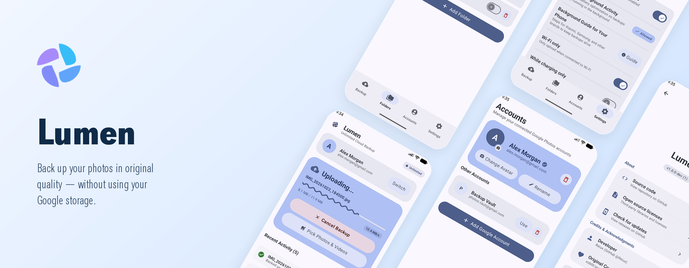
</p>

> [!NOTE]
> **Disclaimer:** Lumen is an independent open-source project and is not affiliated with, endorsed by, or supported by Google LLC. Google Photos is a trademark of Google LLC.
>
> **No root or mods needed.** Works on standard Android phones (Android 8.0+).  
> *Looking for the desktop version? Check out **[Lumen for Desktop](https://github.com/Reiux/Lumen)**.*
>
> *Product website & screenshots: **[reiux.github.io/lumen-site](https://reiux.github.io/lumen-site/)**.*

Lumen is an open-source Android app that backs up your camera roll directly to Google Photos in original quality.

### How it works

Lumen lets you back up photos and videos straight from your phone to Google Photos. It talks directly to Google's mobile upload endpoints with device profile headers, so your media can upload in full original quality without eating your storage quota.

Everything runs locally on your phone. No middleman servers, no paid accounts, no ads, and no tracking.

---

## Security & Account Access

**Your password is never requested, stored, or seen by Lumen.**

When you sign in, Google gives the app an **OAuth token**.
- It works like a temporary key card that only lets Lumen put photos into your Google Photos library.
- It cannot read your emails, open your Google Drive files, or change your account details.
- Uploads go straight from your phone to Google (`photos.googleapis.com`). No outside server ever touches your data.
- The app makes zero analytics or telemetry calls. It only contacts `api.github.com` to check for app updates when automatic update checks are enabled (which can be turned off in Settings).

---

## Features

- **Original Quality Uploads**: Back up photos and videos at full resolution without filling up your Google One storage.
- **Direct & Private**: Connects straight from your phone to Google Photos with no analytics or telemetry. The only other server it contacts is GitHub, to check for app updates, and you can turn that off in Settings.
- **Material 3 Expressive UI**: Built with Compose, spring animations, shape-changing buttons, and customizable color themes.
- **Tablet & Foldable Support**: Adapts into a side-by-side split screen on larger displays or landscape mode.
- **Live Status Bar Updates**: Shows progress chips in your status bar with live speed and file counters while backing up.
- **Duplicate Prevention**: Checks files locally and in the cloud before uploading so you don't re-upload photos you already have.
- **Background Sync**: Pauses and resumes automatically when connected to Wi-Fi or a charger.
- **Self-Diagnostics & Logs**: Built-in test suite, battery setup guides for Xiaomi, Samsung, and OnePlus devices, and live activity logs.
- **Hidden Features**: A few hidden surprises tucked around the app to find.

---

## Screenshots

| Active Backup | Folder Mapping | Accounts | Settings & Themes |
| :---: | :---: | :---: | :---: |
| 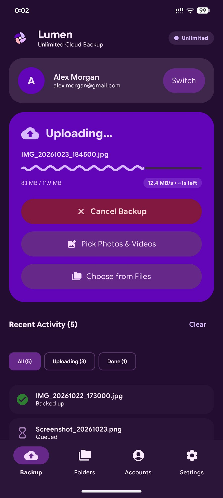 | 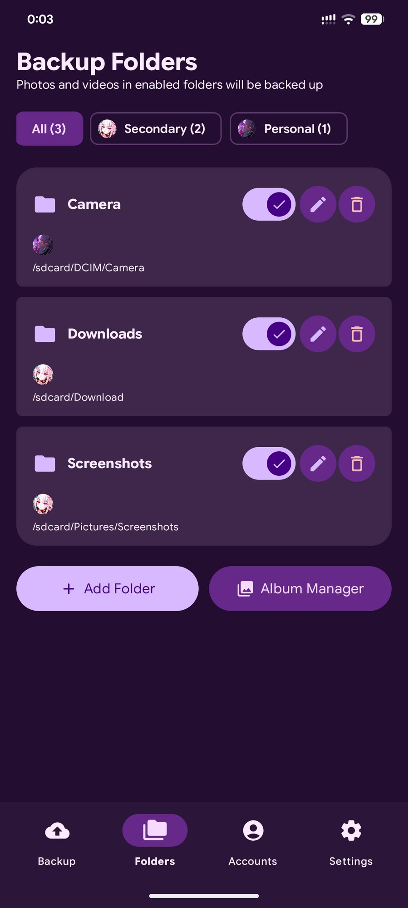 | 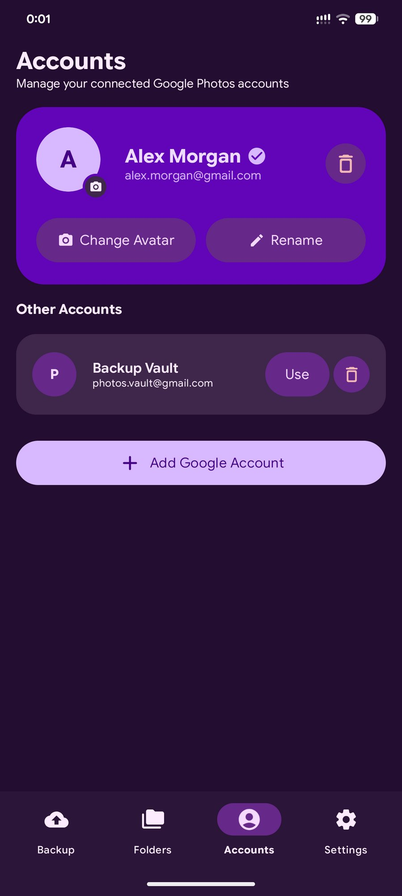 | 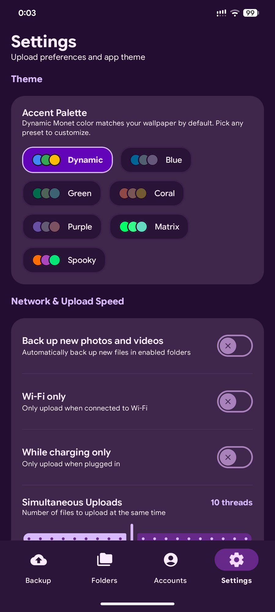 |

<details>
<summary><b>View All Screenshots (Onboarding & Extra Screens)</b></summary>
<br>

### Onboarding Flow

| 1. Welcome | 2. Permissions | 3. Connect Account | 4. Preferences | 5. You're All Set |
| :---: | :---: | :---: | :---: | :---: |
| 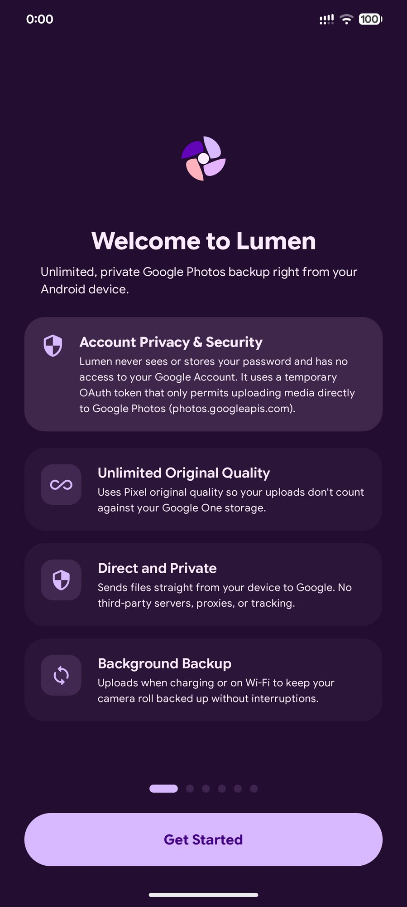 | 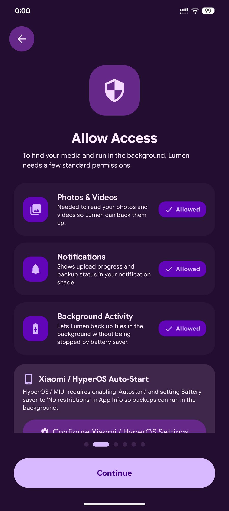 | 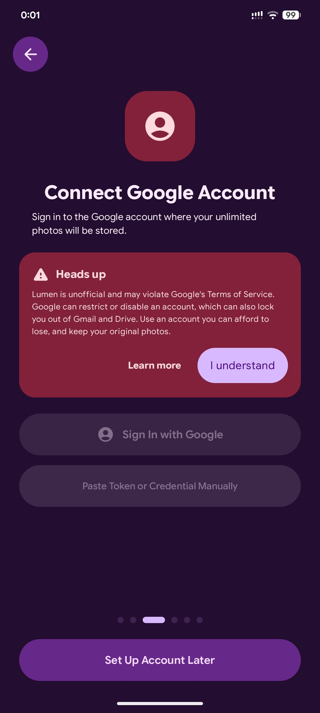 | 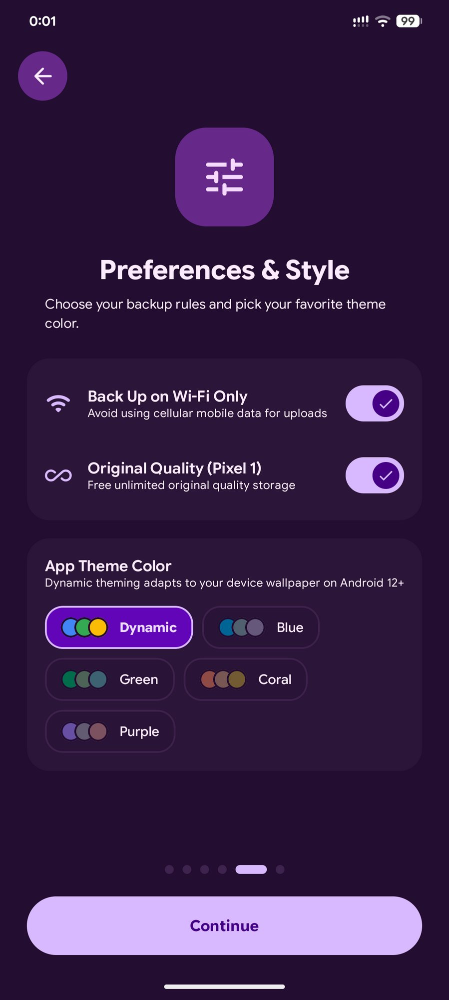 | 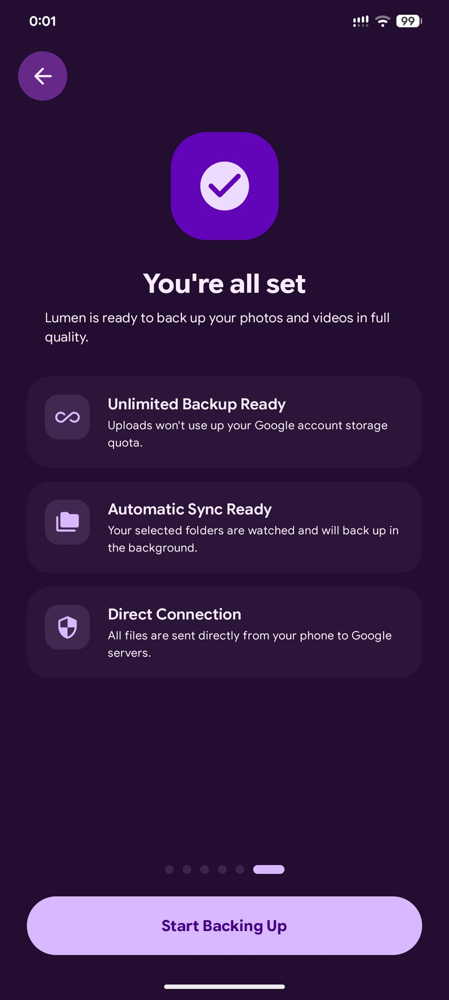 |

### Additional Screens

| Idle State | Album Manager | Storage Cleanup | About Lumen |
| :---: | :---: | :---: | :---: |
| 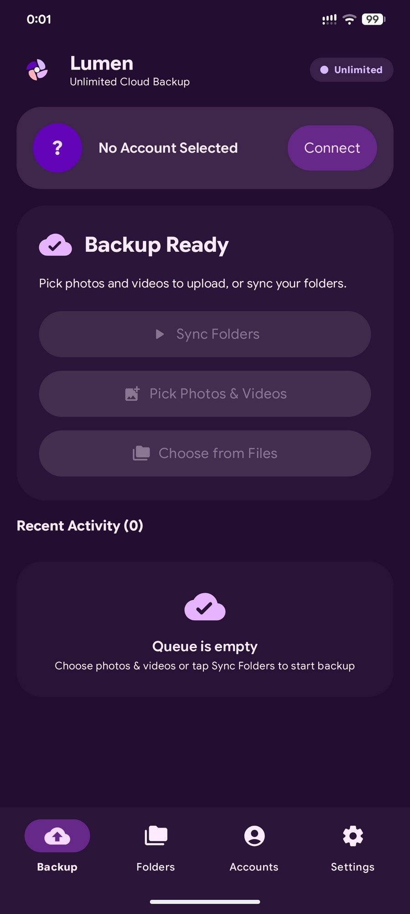 | 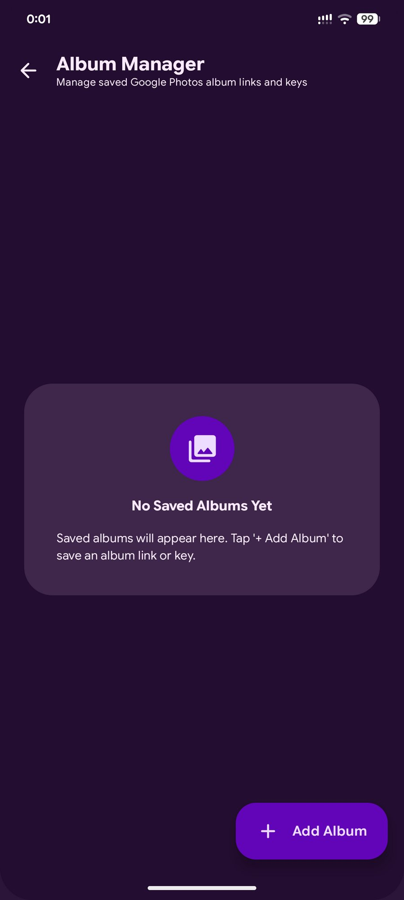 | 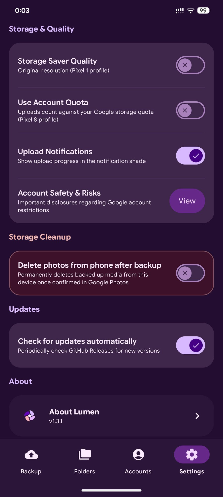 | 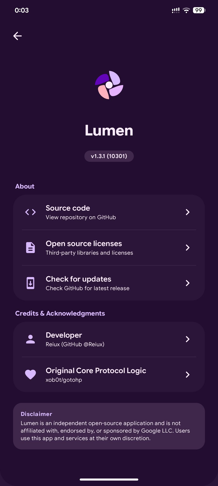 |

</details>

---

## Supported Formats

<details>
<summary>View supported file types</summary>

| Category | Formats |
|---|---|
| Images | JPEG, PNG, WEBP, HEIC, GIF, RAW (DNG) |
| Videos | MP4, MOV, WEBM, MKV, 3GP, AVI |

</details>

---

## Requirements

- Android 8.0 or Later
- Google Account
- Network connection (Wi-Fi or Mobile Data)

---

## Download

Get the latest APK on the [Releases](https://github.com/Reiux/lumen-android/releases) page:
- `lumen-release.apk` (Standard app)
- `lumen-test-debug.apk` (Developer build with debug tools)

---

## Building from Source

Official releases are signed with a private key. Local release builds use the debug key and cannot update over official installs.

```bash
git clone https://github.com/Reiux/lumen-android.git
cd lumen-android

# Build Debug and Release APKs
env -u ANDROID_PREFS_ROOT ./gradlew assembleDebug assembleRelease
```

---

## Credits

- **Developer**: [Reiux](https://github.com/Reiux)
- **Core Protocol**: Thanks to [xob0t/gotohp](https://github.com/xob0t/gotohp) for reverse-engineering the Google Photos upload protocol and authentication logic.

---

## Account Safety & Risks

Lumen is an unofficial tool and isn't affiliated with Google. It uploads photos using mobile endpoints that aren't part of an official public API.

- **Terms of Service**: Using unofficial clients might violate Google's Terms of Service. Google can log you out, rate-limit, or restrict your account at any time.
- **Gmail & Drive Access**: If Google flags or restricts your account, you could lose access to other Google services linked to that email.
- **Use a Secondary Account**: Don't use your main personal email, or anything tied to school, work, or banking. Use a throwaway or secondary account you're fine losing.
- **Keep Your Local Copies**: Never treat Google Photos as your only backup. Keep the original files on your phone or local storage until verified.
- **Avoid Repeated Sign-Ins**: If Google logs you out or asks for verification, don't spam sign-in attempts. Lumen automatically pauses when it detects account issues. Each sign-in registers a new device, so avoid logging in and out repeatedly.

---

## Disclaimer

Lumen is an independent open-source project and is not affiliated with, endorsed by, or supported by Google LLC. Google Photos is a trademark of Google LLC. Use at your own risk. The software is provided "as-is" under the Apache 2.0 license.

---

## License

Distributed under the [Apache License 2.0](LICENSE).
