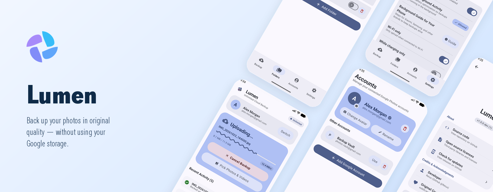

# Lumen

**Unlimited Google Photos backup for your phone in full original quality.**


[](https://developer.android.com)

<p align="center">
  
</p>

> [!NOTE]
> **No root or mods needed.** Works on standard Android phones (Android 8.0+).  
> *Looking for the desktop version? Check out **[Lumen for Desktop](https://github.com/Reiux/lumen)**.*

Lumen is an open-source Android app that backs up your camera roll to Google Photos without using up your Google account storage.

### How it works
Google gives free original-quality uploads to certain Pixel devices. When you back up through Lumen, the app sends your photos directly from your phone to Google Photos with headers that tell Google's upload servers the files are coming from a Pixel. Google stores them at full resolution, and your storage space stays untouched.

Everything runs on your phone. No middleman servers, no paid accounts, no ads, and no tracking.

---

## Security & Account Access

**Your password is never requested, stored, or seen by Lumen.**

When you sign in, Google gives the app an **OAuth token**.
- It works like a temporary key card that only lets Lumen put photos into your Google Photos library.
- It cannot read your emails, open your Google Drive files, or change your account details.
- Uploads go straight from your phone to Google (`photos.googleapis.com`). No outside server ever touches your data.

---

## Features

- **Unlimited Original Quality**: Upload photos and videos at full resolution without filling up your Google One storage.
- **Direct & Private**: Connects straight from your phone to Google Photos with zero analytics or third-party servers.
- **Material 3 Expressive UI**: Built with Compose, spring animations, shape-changing buttons, and customizable color themes.
- **Tablet & Foldable Support**: Adapts into a side-by-side split screen on larger displays or landscape mode.
- **Live Status Bar Updates**: Shows progress chips in your status bar with live speed and file counters while backing up.
- **Duplicate Prevention**: Checks files locally and in the cloud before uploading so you don't re-upload photos you already have.
- **Background Sync**: Pauses and resumes automatically when connected to Wi-Fi or a charger.
- **Self-Diagnostics & Logs**: Built-in test suite, battery setup guides for Xiaomi, Samsung, and OnePlus devices, and live activity logs.
- **Hidden Features**: A few hidden surprises tucked around the app to find.

---

## Supported Formats

<details>
<summary>View supported file types</summary>

| Category | Formats |
|---|---|
| Images | JPEG, PNG, WEBP, HEIC, GIF, RAW (DNG) |
| Videos | MP4, MOV, WEBM, MKV, 3GP, AVI |

</details>

---

## Requirements

- Android 8.0 or newer
- Google Account
- Network connection (Wi-Fi or Mobile Data)

---

## Download

Get the latest APK on the [Releases](https://github.com/Reiux/lumen-android/releases) page:
- `lumen-release.apk` (Standard app)
- `lumen-dev-debug.apk` (Developer build with debug tools)

---

## Building from Source

Official releases are signed with a private key. Local release builds use the debug key and cannot update over official installs.

```bash
git clone https://github.com/Reiux/lumen-android.git
cd lumen-android

# Build Debug and Release APKs
env -u ANDROID_PREFS_ROOT ./gradlew assembleDebug assembleRelease
```

---

## Credits

- **Developer**: [Reiux](https://github.com/Reiux)
- **Core Protocol**: Thanks to [xob0t/gotohp](https://github.com/xob0t/gotohp) for reverse-engineering the Google Photos upload protocol and authentication logic.

---

## Account Safety & Risks

Lumen is an unofficial tool and isn't affiliated with Google. It uploads photos using an unofficial method that Google didn't design for third-party apps.

- **Terms of Service**: Using Lumen may break Google's Terms of Service. Google can log you out, limit, or ban your account at any time.
- **Gmail & Drive Access**: If Google restricts your account, you could lose access to Gmail, Google Drive, and other services linked to that email.
- **Use a Secondary Account**: Use an email you're okay with losing access to. Don't use your primary personal email or accounts used for work, school, or banking.
- **Keep Your Local Copies**: Don't rely on Google Photos as your only backup. Keep your original files on your phone or local storage.
- **Avoid Repeated Sign-Ins**: If Google logs you out or asks for verification, don't spam sign-in attempts. Lumen will pause automatically when it detects account issues. Each sign-in registers a new device, so avoid logging in and out repeatedly.

---

## Disclaimer

Lumen is an independent open-source project and is not affiliated with or endorsed by Google LLC. Using Lumen may violate Google's Terms of Service and can result in account restrictions. Use at your own risk. The software is provided "as-is" under the Apache 2.0 license.

---

## License

Distributed under the [Apache License 2.0](LICENSE).
